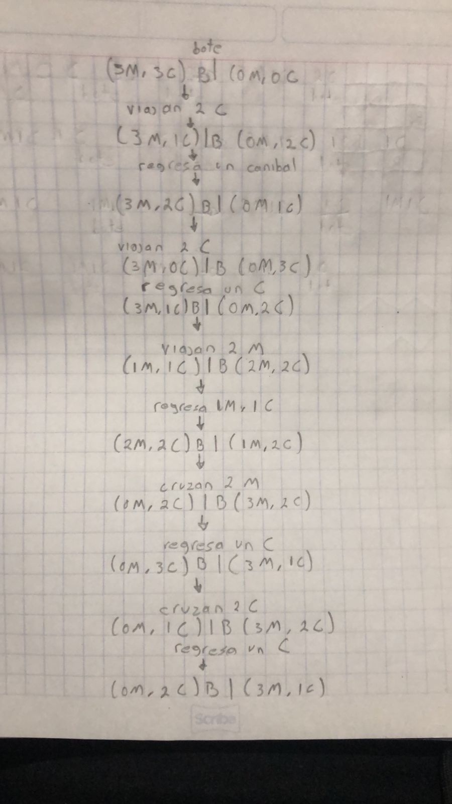
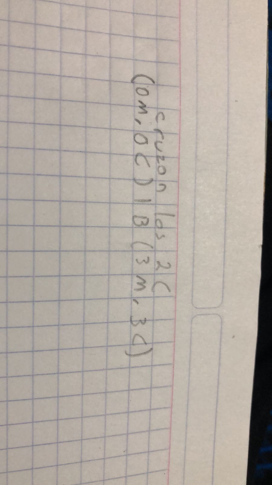
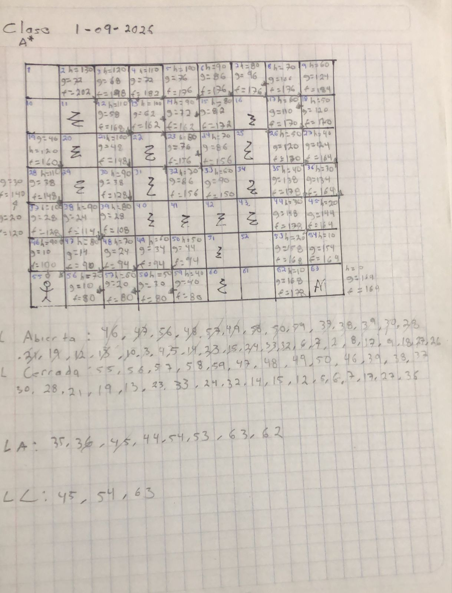
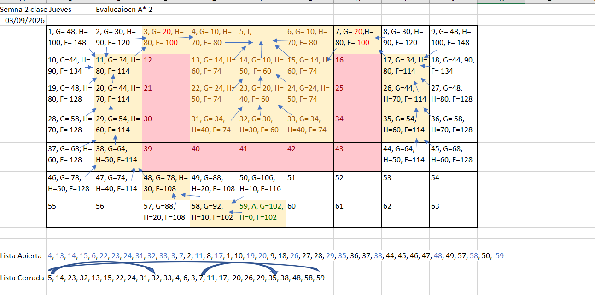
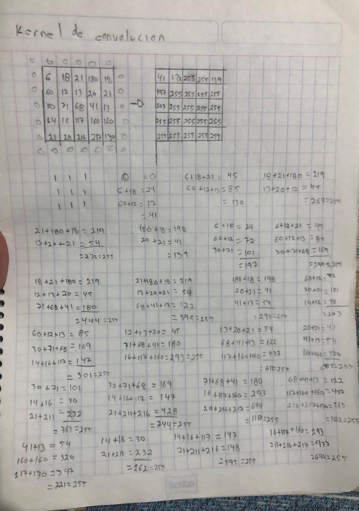

# Trabajos y tareas

## Trabajos en clase - 27/08/2026

- **Monjes y canibales**
  Estas son las imagenes del recorrido para pasar a los monjes y canibales de un extremo al otro sin dejar mas canibales que monjes de un lado u otro.
  

- **Laberinto**

- **Contar islas**
  [Código para contar islas](./contar_islas.py)

## Ejercicio de A\* clase 01/09/2026

Captura de ejercicio de A\*

## Evalución A\* clase - 03/09/2026

Captura del ejericico en clase de A\*

## Dataset Iris Clase 08/09/2026

El Dataset analizado en clase tiene 4 columnas con 150 registros con valores numericos. Estos datos pertenecen a una matriz de caracteristicas del **Dataset Iris**, donde cada fila representa una muestra, aqui las 4 columnas representan las medidas de la anatomia de una flor Iris, estas medidas estan en centimetros.

1. Longitud del sépalo (Sepal Length)
2. Ancho del sépalo (Sepal Width)
3. Longitud del pétalo (Petal Length)
4. Ancho del pétalo (Petal Width)

Estas dimensiones son la clave matemática que permite diferenciar entre tres especies distintas de la flor Iris, las cuales son la **Iris setosa**, **Iris virginica** y la **Iris versicolor**.

En la materia de Inteligencia Artificial y el Machine Learning, el dataset Iris es como el "Hola Mundo" del análisis de datos. Se utiliza principalmente para Entrenar modelos para que al recibir las 4 medidas de una flor nueva, se pueda predecir a que especie pertence, esto por medio de arboles de desicion o redes neuronales, y esto pertenece a el aprendizaje supervisado si estan etiquetadas las 4 columnas.En el caso del archivo de la clase no tiene las etiquetas en las columnas, esto es util para algoritmos como _K-Means_, los cuales buscan encontrar los patrones y separar los datos en 3 grupos naturales basándose únicamente en la similitud de sus medidas numéricas.

Tambien este tipo de dataset es util para pruebas y valdiaciones, ya que sirve para probar que un nuevo algoritmo esté funcionando correctamente antes de pasar a problemas más complejos.

## Actividad — Árboles de decisión

### 1. ¿Qué es un árbol de decisión y cuál es su objetivo principal dentro de un problema de clasificación?

Un árbol de decisión es un algoritmo que funciona como un diagrama de flujo. Su objetivo principal en la clasificación es dividir un conjunto de datos grande y mezclado en grupos cada vez más pequeños y específicos, realizando divisiones basadas en las características de los datos hasta llegar a una conclusión o categoría final.

### 2. Explique con sus propias palabras los siguientes elementos de un árbol de decisión:

**Nodo raíz**: Es el punto de inicio y representa la característica más importante del conjunto de datos.
**Nodo interno**: Es un nodo de paso, donde se evalúan decisiones para dividir los datos.
**Rama**: Sirven como caminos entre los nodos.
**Hoja**: Es el final del camino, la decisión a la que se llega.

### 3. ¿Qué es una red neuronal multicapa y qué función cumplen las siguientes capas?

Es un modelo matemático inspirado en el cerebro humano, compuesto por múltiples "neuronas" artificiales conectadas entre sí, este hecho para encontrar patrones muy complejos.

- **Capa de entrada**: Solo recibe los datos crudos del problema y los introduce a la red.

- **Capa oculta**: Es el motor de procesamiento donde las neuronas aplican operaciones matemáticas para detectar patrones y características abstractas en los datos. Se llama así porque no interactúa directamente con los datos de entrada ni con el usuario final.

- **Capa de salida**: Es la que entrega el resultado final o predicción final a partir de la información procesada anteriormente.

### 4. ¿Qué representan los pesos y los sesgos dentro de una red neuronal?

**Pesos**: Representan la fuerza de la conexión entre dos neuronas. Determinan qué tanta influencia tiene una variable de entrada sobre el resultado.
**Sesgos**: Funcionan como un ajuste adicional o margen de maniobra. Permiten que la neurona se active incluso si las entradas son iguales a cero, desplazando la función matemática para que se ajuste mejor a los datos reales.

Cambian porque ese es exactamente el proceso de aprender, ya que durante el entrenamiento, la red hace una predicción, calcula qué tan equivocada estuvo, y ajusta matemáticamente los pesos y sesgos hacia arriba o hacia abajo para que, en el siguiente intento, el error sea menor.

### 5. ¿Cuál es la principal diferencia entre la forma en que aprende un árbol de decisión y la forma en que aprende una red neuronal multicapa?

El árbol de decisión aprende mediante reglas lógicas de división. Evalúa característica por característica y busca el punto de corte que mejor separe las clases. El elemento que aprende es la estructura del árbol, para saber qué variable va en qué nodo y cuál es el valor de corte.

La red neuronal aprende mediante la optimización de funciones continuas, mezcla todas las variables simultáneamente usando ecuaciones algebraicas. El elemento que aprende son los valores numéricos de los pesos y sesgos a través de miles de ajustes iterativos.

### 6. Una institución bancaria desea desarrollar un sistema que detecte posibles compras fraudulentas.

_El sistema dispone de información como:_

Monto de la compra.
Hora de la operación.
Ciudad donde se realizó.
Tipo de establecimiento.
Número de compras realizadas durante el día.
Historial de compras del cliente.
Analice las ventajas y desventajas de utilizar un árbol de decisión y una red neuronal multicapa.

**Árbol de decisión:**
_Ventajas_: Alta velocidad de ejecución, y permite a los analistas de seguridad leer las reglas exactas para el fraude

_Desventajas_: Un árbol puede quedarse corto ante patrones de fraude muy sutiles que involucren múltiples variables a la vez, ya que estos actualizan sus tecnicas.

**Red Neuronal:**
_Ventajas_: Es excelente para encontrar correlaciones no lineales y ocultas entre cientos de variables.

_Desventajas_: Funciona como caja negra, ya que, si bloquea la tarjeta de un cliente legítimo, el banco no sabrá explicarle exactamente por qué.

Elección recomendada: Una red neuronal ya que puede adaptarse de mejor manera a las tácticas ocultas que realicen para los fraudes.

### 7. Una escuela quiere detectar estudiantes que presentan riesgo de reprobar una materia.

_Se conocen variables como:_

_Asistencia._
_Calificaciones._
_Tareas entregadas._
_Participación._
_Número de materias reprobadas anteriormente._

Un arbol de decisiones permite ver de mejor manera no solo la predicción del estudiante que reprobara, si no que permite ver tambien ver los motivos mediante las evaluaciones de decisiones.

### 8. Un hospital desarrolla un sistema para determinar qué pacientes necesitan atención prioritaria utilizando:

_Edad._
_Temperatura._
_Presión arterial._
_Frecuencia cardiaca._
_Síntomas._
_Antecedentes médicos._

No ya que es la vida de una persona, y si el sistema clasifica mal a un paciente, no se podrá conocer la razón de esto, por lo tanto no se podría corregir fácilmente.

### 9. Una empresa de reparto quiere predecir si un pedido llegará tarde considerando:

_Distancia._
_Tráfico._
_Clima._
_Hora del día._
_Cantidad de pedidos._
_Experiencia del repartidor._

Para determinar quien realiza la mejor predicción es necesario saber el por que de la decisión o las reglas que utilizaron para la predicción, y revisar la probabilidad que arroja la decisión final, ya que la respuesta de la red neuronal es un tal vez, es decir puede ser como si llega o no tarde, mientras que la del arbol se muestra mas segura.

### 10. Una empresa desarrolla dos sistemas para decidir si una persona puede recibir un crédito.

_El primer sistema utiliza un árbol de decisión y permite explicar claramente por qué una solicitud fue rechazada._

_El segundo utiliza una red neuronal multicapa y obtiene mejores resultados de predicción, pero es más difícil explicar sus decisiones._

_Si usted fuera responsable del proyecto:_

_¿Cuál de los dos modelos utilizaría?_
_¿Qué ventajas tendría su elección?_
_¿Qué riesgos tendría?_
_¿Consideraría posible utilizar ambos modelos dentro del mismo sistema?_

Tomaría el árbol de decisiones, ya que se le podría explicar de mejor manera al cliente el rechazo. El riesgo es que puede perder algunos clientes que si pudieron haber cumplido con los requisitos. Si sería recomendable usar los, podrían usarse los 2 a la vez, usar principalmente la red por su precisión y dependiendo el resultado que arroje usar el árbol, para basarse en el porqué de este y explicar al cliente.

## Actividad en clase filtro Kernel de convolución

Captura del ejericico de Kernel de convolución

